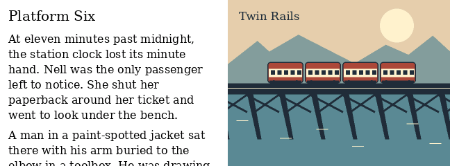

# nFolio

Read light novels, manga and long-strip comics on a colour TI-Nspire CX or CX II with Ndless. nFolio remembers each book’s place, lets you follow embedded PDF links, and switches between single pages, two-page spreads and continuous scrolling.



## Start reading on the calculator

1. Copy the included [folio](folio) folder directly into **My Documents** on the calculator. Keep its name lowercase. The launcher belongs at `My Documents/folio/Folio.tns`.
2. Open `Folio.tns`. Select **Light Novels → Platform Six** to try prose, **Manga → Twin Rails** for a two-page illustration, **Manhua → Night Signal** for scrolling, or **PDF → Station Atlas** for clickable links.
3. Put your own `.folio.tns` books in `folio`. Each folder below it becomes a shelf section, and sections can be nested. Reopen the launcher after transferring books.

The touchpad controls were developed for the **CX II CAS on OS 6.2.0.333 with Ndless r2023**. Desktop release **0.4.6** works with the **0.4.4** calculator reader. If you already have that reader, you can update just the desktop tools. When updating an older handheld installation, replace `folio/Folio.tns` and keep your books and saves.

## Pack books on Windows, Linux or macOS

Install **Python 3.10 or newer**. Open a terminal in the extracted project folder, where `Pack.cmd` and `requirements.txt` are side by side. Run the two setup commands for your platform once. The launcher automatically uses the local Python environment they create.

### Windows

```powershell
py -3 -m venv .venv
.\.venv\Scripts\python.exe -m pip install -r requirements.txt
```

Drag any mix of book files, whole library folders and manga picture folders onto **Pack.cmd** in Explorer. You can also run it from PowerShell.

```powershell
.\Pack.cmd "C:\Books\Light Novels" "C:\Books\Manga"
```

If your Python installation provides `python` instead of `py`, use `python -m venv .venv` for the first command.

### Linux and macOS

```sh
python3 -m venv .venv
./.venv/bin/python -m pip install -r requirements.txt
```

Use the same **Pack.cmd** from a terminal. Type `sh ./Pack.cmd` followed by a space, drag files or folders into the terminal to insert their paths, then press **Return**. You can also supply the paths directly.

```sh
sh ./Pack.cmd "$HOME/Books/Light Novels" "$HOME/Books/Manga"
```

Using `sh` works even if the ZIP extractor or GitHub upload dropped the executable permission. Press **Return** after each preset choice on Linux and macOS.

### What gets packed

Pick compression and resolution once per batch. For PDF light novels, start with **2 · Smallest**, then **1 · Auto**. Smallest can reuse letter shapes from the original PDF’s text layer. Auto keeps 640-pixel-wide artwork for zoom. Choose **2 · Fit only** at the resolution prompt to store 320-pixel artwork instead.

| Example source layout | Result |
| --- | --- |
| `Novels/Vol 01.pdf` and `Novels/Vol 02.epub` | Two books, each next to its source. TXT, CBZ and comic ZIP files also pack individually. |
| `Manga/Vol 01/1.jpg`, `2.jpg`, `10.jpg` | One `Manga/Vol 01.folio.tns` with pages in numeric order. |
| `Series/Vol 02/Chapter 1/` and `Chapter 2/`, each containing images | One `Series/Vol 02.folio.tns` with two chapters. |
| `Series/01/` and `Series/02/`, each containing images | Pass `Series` to make one book with two numbered chapters. Pass `01` and `02` themselves to make two books. |

The packer searches recursively and converts up to four books at once by default. Overlapping inputs are processed once. A failed book is listed by path while the rest finish. Existing `.folio.tns` files are skipped during a folder scan. Pass one explicitly to recompress it. Transfer the finished books into the shelf sections you want.

For an unattended batch, call `pack_batch.py` with explicit settings. On Windows use `.\.venv\Scripts\python.exe` in place of `./.venv/bin/python`.

```sh
./.venv/bin/python pack_batch.py "Light Novels" "Manga" --compression smallest --jobs 4
```

## Reading controls

| Control | Action |
| --- | --- |
| **Up / Down** and **Left / Right** | Scroll vertically or turn pages. When magnified, use the arrows to pan. |
| **Centre click** or **Z** | Toggle 1.5× zoom on a page or spread. |
| **Double centre click** or **D** | Toggle a two-page spread. The spread opens fitted. Returning to a single page restores that book’s margin trim. |
| **× / ÷** | Adjust centred margin trim by 0.05× per press. Each book remembers its setting. |
| **Ctrl + glide**, then **click** | Show the cursor while Ctrl is held. Click an embedded PDF link to jump to its destination. |
| **Ctrl + centre click** away from a link | Switch between paged and continuous scrolling. |
| **Menu** | Open the reader menu. From bookmarks or chapters, return to that menu. |
| **+ / −** | Turn a source page or pair, including while zoomed. |
| **Esc** | Return from reading to the current shelf section. |

The [reader and packer guide](docs/guide.md) covers spread direction and pairing, per-book saves, covers and dark mode, custom wallpaper, supported input formats and compression settings.

## Build from source

The compiled reader is included at [folio/Folio.tns](folio/Folio.tns). To rebuild it, put the Ndless SDK and its ARM compiler on your `PATH` and run `make` from the project root. This writes `Folio.tns` in that directory. Run `make host` to build the desktop test renderer.

Build details and regression commands are in the [testing guide](docs/guide.md#build-and-tests). Bundled dependencies and fonts have their own [component notices](third_party/NOTICES.md) and [font licence](fonts/LICENSE.txt).
